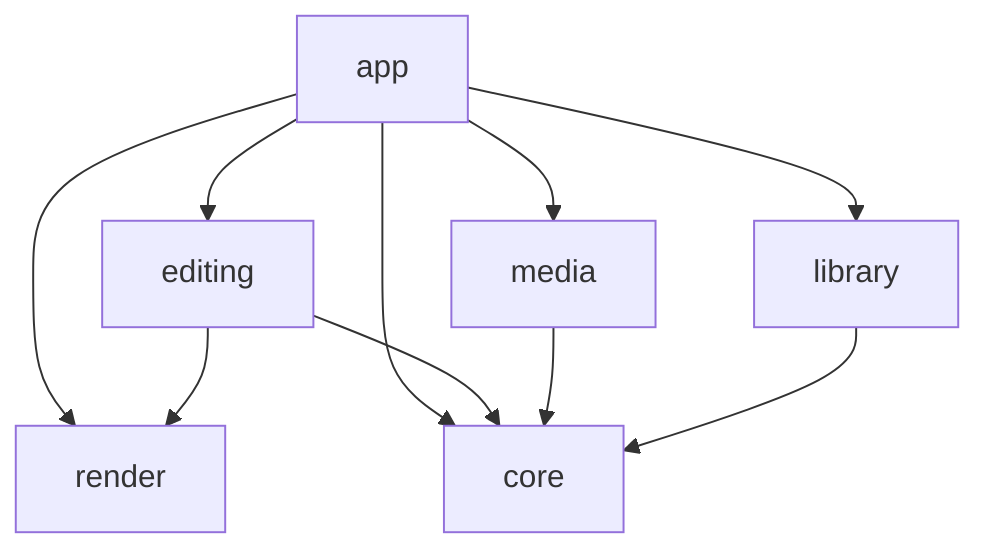

# Frontend module structure

The frontend is split into five reusable TypeScript packages and one thin Lit app. This page records why and which rules keep it that way. For a map of the code with links, see [Architecture](../02-technical/01-architecture.md).

## Goals

- Reusable packages that know nothing about Lit, Tauri, or the app.
- One package owns the whole image rendering pipeline, from a decoded image to pixels on a canvas or in a JPEG.
- A clean repository root and one obvious place for every kind of code.
- Object-oriented code in files of at most 300 lines.
- Easy to extend with new editing tools, and later with feature extraction and AI tools.
- The UI framework can be replaced without rewriting behaviour.

The refactor changed structure, not behaviour. The native commands, the sidecar formats, and the Rust backend are untouched, and the shader code moved verbatim.

## What was in the way

- **Rendering could not be loaded without Lit.** The shader composer imported the editor registry, which imported every tool controller.
- **The rendering pipeline was spread over four areas.** Settings, shaders, the WebGL program, and the view and export code each lived somewhere else, the last inside a 2488-line canvas element.
- **Four files held over a third of the frontend.** The app shell had 2831 lines, the image canvas 2488, the full view 1574, and the photo grid 1312.
- **Services were module-level functions with module-level state.** Fifteen service files called Tauri directly.
- **Adding a tool touched a wide contract.** The editor state interface had 33 methods, one group per tool.

## Structure

```
Warble/
├── 00 docs/
├── app/                 the Lit and Tauri frontend
├── packages/            reusable modules
│   ├── core/
│   ├── render/
│   ├── editing/
│   ├── media/
│   └── library/
├── scripts/
├── src-tauri/           native backend
├── package.json
├── pnpm-workspace.yaml
└── tsconfig.base.json
```

Every package has the same shape: a `package.json` that exports only `src/index.ts`, one folder per responsibility under `src/`, and its own `tests/`. Packages are consumed as TypeScript source through the pnpm workspace, so there is no per-package build step.



## Decisions

- **The app lives in `app/`.** The root holds no source or bundler files.
- **`core` is its own package.** It removes the subscribe, cache, and debounce code each service used to repeat.
- **Tauri stays in the app.** Packages declare interfaces; [the Tauri platform](../../app/src/platform/tauri-platform.ts) implements them. Running outside Tauri needs one new [platform](../../app/src/platform/platform.ts).
- **Tests run on Vitest** inside the package they cover, against classes built with fake ports.
- **The UI kit stays in the app** because it is Lit-specific.

## Rendering as a pipeline

[The render pipeline](../../packages/render/src/pipeline/render-pipeline.ts) runs an ordered list of stages. Two registries are the extension points:

- [The effect registry](../../packages/render/src/effects/effect-registry.ts) lists the effects and fixes their order.
- [The tool registry](../../packages/editing/src/tools/tool-registry.ts) lists the tools, their scopes, and their order in the panel.

A [render recipe](../../packages/render/src/recipe/render-recipe.ts) is plain data, so the same recipe drives the screen, the export, and tests. [Image editing](../02-technical/04-image-editing.md) explains the stages and how to add an effect, a stage, or a tool.

## Keeping Lit replaceable

Lit is confined to view files in the app.

- Elements declare properties, render a template, and delegate.
- Behaviour lives in plain classes named `*-controller.ts`. They take a small host interface, usually one `requestUpdate` method, and their dependencies through the constructor.
- Styles sit in their own files next to the element.
- Elements read shared objects from [the app context](../../app/src/composition/app-context.ts); controllers never do.

Replacing Lit means rewriting the element and style files. Controllers, state, platform, and all packages stay.

## Conventions

- **Classes.** Behaviour lives in classes with constructor-injected dependencies. Ports are interfaces. Persisted shapes stay plain interfaces so they remain JSON-compatible. Small pure helpers may stay functions.
- **No module-level state.** The app context decides what is shared.
- **One class per file**, named after the class in kebab-case.
- **300 lines per file at most**, including shader, style, and test files.
- **Comments only where the reason is not obvious from the code.**

[The structure check](../../scripts/check-structure.mjs) enforces the line limit and the import rules as part of `pnpm check`.

## How the refactor was verified

- `pnpm check`, `pnpm test`, and `pnpm build` pass. Every case of the previous test file has a successor in the new suites.
- The new pipeline was compared with the previous renderer on eleven recipes covering every effect, both layers, a cropped reduced preview, and target release. Every pixel matched.
- The previous and the refactored app were run side by side against a stubbed backend at three window widths. Screenshots of twelve screens matched.

Folder import, reconnect and removal, drag to album, window fullscreen, and the iPad layout were not exercised in a browser and need a pass in `pnpm tauri dev`.
