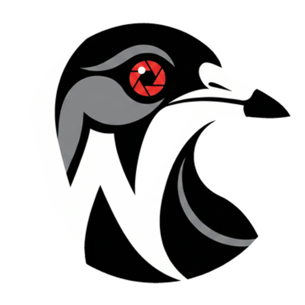

# Warble
 


#This is a work in progress. The App was build using AI.#

Warble is photo viewer with small editing and presentation features built for mac. Built with Vite, TypeScript, and Tauri.

## Documentation

See the [documentation index](<00 docs/README.md>) for feature guides and technical overviews.

## Getting Started

To start the app in development mode:

```sh
pnpm install
pnpm dev
```

## Structure

- `app/` — the Lit and Tauri frontend.
- `packages/` — reusable TypeScript modules: `core`, `render`, `editing`, `media`, `library`.
- `src-tauri/` — the Rust backend.

## Checks

```sh
pnpm check   # types for every package and the app, plus the structure rules
pnpm test    # unit tests
```

## Build

To build the Tauri desktop app:

```sh
pnpm tauri build
pnpm tauri ios build
```

### Running the App on macOS

After building, you can find the macOS app in the `src-tauri/target/release/bundle/macos/` folder. Double-click the `.app` file to launch Warble on your Mac.

A fast, native photo viewer built with Tauri + Lit.
